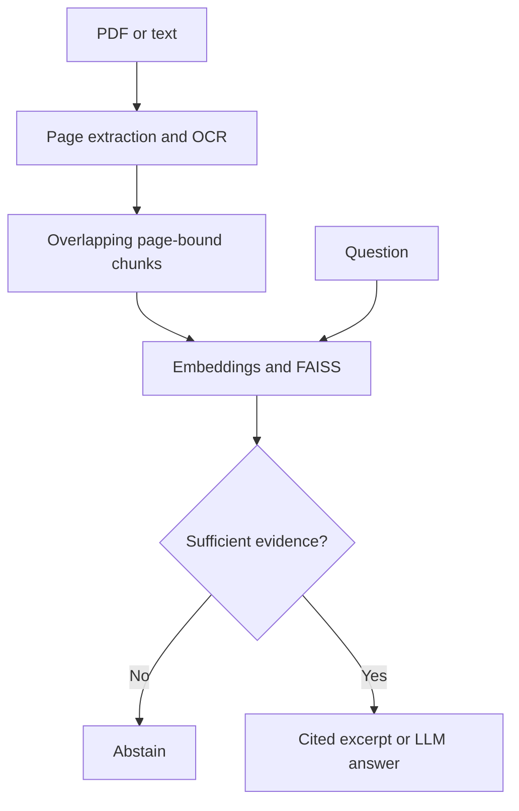

# Retail Policy Search Assistant

**Page-cited document search with PDF extraction, OCR, FAISS retrieval and optional LLM answers.**

Python · Embeddings · FAISS · OCR · Streamlit · Optional LLM API

Ask about returns, deliveries, product care or stock-handling procedures. The app shows the answer beside the passages it came from, including source filenames and page numbers. The bundled **Cedar Lane** policies are original fictional examples, not real retailer policies.

## Run locally, without an API key

```bash
python -m venv .venv
# Windows: .venv\Scripts\activate
# macOS/Linux: source .venv/bin/activate
python -m pip install -e .
python -m streamlit run app.py
```

The default app indexes eight sample text pages. Try:

- How many days do I have for standard returns?
- What USB adapter should I use to charge the rechargeable lamp?
- What warranty period applies to the rechargeable lamp?

The last question should be refused: the sample guide contains charging instructions, but no warranty terms.

CLI usage:

```bash
python -m policy_search.cli ask "How soon should I report a damaged delivery?"
python -m policy_search.cli evaluate
```

## OCR demonstration

`samples/pdf/product_guide.pdf` contains a normal first page and an **image-only second page**. Install [Tesseract](https://tesseract-ocr.github.io/tessdoc/Installation.html) with English language data and ensure its executable is on PATH. The Docker image installs it automatically.

```bash
python -m policy_search.cli ask "What USB adapter should I use to charge the rechargeable lamp?" --documents samples/pdf
```

PDF text is extracted with pypdf. When a page has fewer than 30 non-whitespace characters, PDFium renders it and Tesseract performs OCR. Original page numbers remain attached to chunks. The real OCR test confirms that `5V 2A` is extracted from page 2 and cited correctly.

The original sample documents can be regenerated with `python scripts/create_samples.py`.

## Embeddings and answer modes

| Setting | Behavior | Network/API key |
|---|---|---|
| `local` embeddings | Stemmed unigram/bigram hashed lexical vectors, 2,048 dimensions, L2-normalized | None |
| `api` embeddings | Dense embeddings from an OpenAI-compatible `/embeddings` endpoint | Required |
| `offline` answers | Exact source sentences with citations and a conservative missing-concept check | None |
| `llm` answers | Generated answer from retrieved passages; structured citation validation | Required |

FAISS `IndexFlatIP` performs exact cosine search on normalized vectors in both modes. **The default embeddings are lexical, not a pretrained neural semantic model.** The local baseline is deliberately inspectable and reproducible. It does not understand every paraphrase or policy exception.

To opt into API mode, export the variables shown in `.env.example` in your shell. The application does not auto-load that file. Set an available model name for your provider; do not put a real key in source code.

```bash
# macOS/Linux example; replace values locally, never in git.
export LLM_BASE_URL="https://api.openai.com/v1"
export LLM_API_KEY="YOUR_KEY"
export LLM_MODEL="YOUR_CHAT_MODEL"
export EMBEDDING_MODEL="text-embedding-3-small"
python -m policy_search.cli ask "When are refunds issued?" --mode llm --embeddings api
```

In PowerShell use `$env:LLM_API_KEY = "YOUR_KEY"` and the same form for the other variables. API embeddings send document text and questions to the configured provider. LLM answers send the question and retrieved passages. Use these modes only for documents you intend to process with that provider; usage may incur provider charges.

The API adapter has mocked request/response tests. **No live paid LLM or embedding call was made during verification**, and no generated-answer accuracy is claimed.

## Retrieval and answer flow



Chunks do not cross pages. The default window is 110 words with 20-word overlap. Every chunk gets a stable content-derived ID. Input limits are 20 documents, 20 MB per document and 50 pages per document. Duplicate filenames are rejected to keep citations unambiguous.

The offline mode refuses questions with substantive concepts absent from the corpus. It also requires a minimum retrieval score. This conservative guard reduces misleading related-text answers but creates false negatives for unfamiliar paraphrases. It is a heuristic, not a proof that an answer follows from a source.

LLM mode treats passages as untrusted data, requests structured output, rejects unknown citation labels and displays evidence for inspection. **A valid citation label does not guarantee that the generated claim is supported.** See [evaluation and limitations](docs/EVALUATION.md).

## Recorded evaluation

Four fictional documents, eight pages, fourteen fixed development questions:

| Check | Result |
|---|---:|
| Answerable source retrieved in top 3 | 10 / 10 |
| Expected answer keyword found | 10 / 10 |
| Unsupported questions refused | 4 / 4 |
| Real scanned-page OCR test | Passed |

This small set was used during development. It is **not** a held-out benchmark, and keyword checks are not semantic answer-accuracy scores. Every answer is recorded in `reports/evaluation.json`; a manual review and failure history are in `docs/EVALUATION.md`.

## Tests and Docker

```bash
python -m pip install -r requirements-dev.txt
python -m pytest -q
docker build -t retail-policy-search .
docker run --rm -p 8501:8501 retail-policy-search
```

Tests cover page boundaries, citation fidelity, empty/unrelated/unsupported queries, duplicate names, API configuration and citation validation, and a real scanned PDF when Tesseract is available. CI installs Tesseract and runs the OCR test. Local tests skip OCR if the system executable is absent. The Docker configuration is included but image execution was not available during verification.

The Streamlit app is a **local, single-user demonstration**, not a hardened public document service. Uploaded content and cached indexes remain in process memory until the process/cache is cleared. Do not deploy it as a multi-tenant service without authentication, per-user cache isolation, retention controls and additional document-processing limits.

## Repository guide

- `policy_search/`: extraction, indexing, source-bound answers, API adapter and CLI.
- `samples/text/` and `samples/pdf/`: original fictional sample documents, MIT-licensed with the code.
- `evaluation/questions.json`: development questions and expected source references.
- `reports/evaluation.json`: reproducible per-question output.
- `docs/EVALUATION.md`: manual review, error analysis and next steps.

For interviews, be ready to explain retrieval versus generation, lexical versus semantic embeddings, why page citations matter, why a confidence threshold is imperfect, and what evidence is needed before claiming an assistant is reliable.
